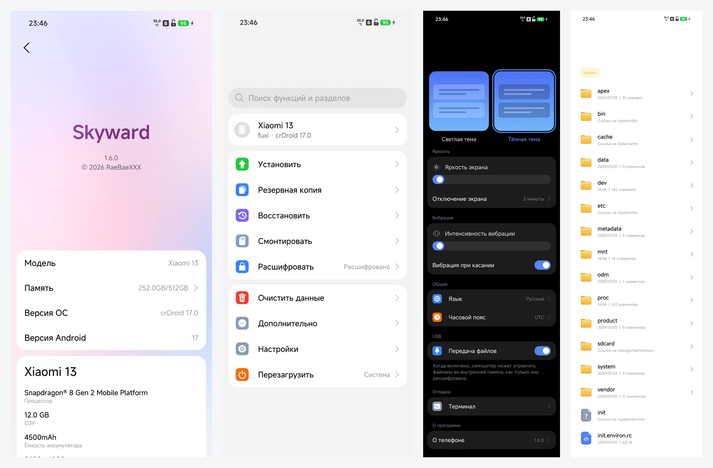
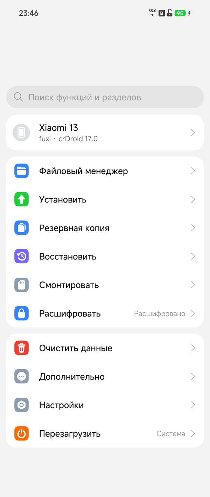
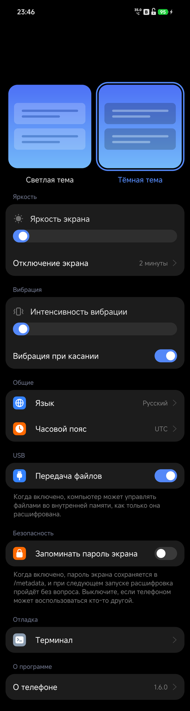
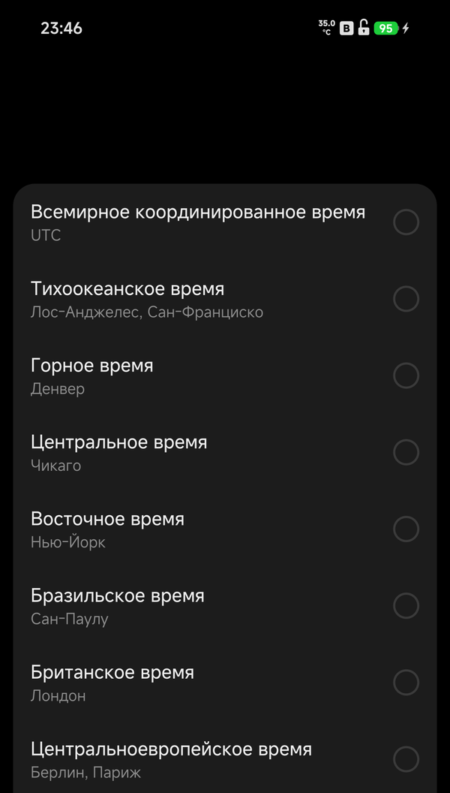

# Skyward for fuxi

English | [Русский](README.ru.md)

Skyward is a recovery written in Rust, from scratch. This fork is dedicated to
one phone: the **Xiaomi 13** (codename `fuxi`), and is maintained by
**RaeBaeXXX**. For the other devices the upstream project supports, see
[kirklin/skyward](https://github.com/kirklin/skyward).



<p align="center">
  
  
  
</p>

## Features

- **Opens the data partition.** Wrapped keys through the phone's key service,
  file-based encryption, and the users' own files behind their screen lock.
- **Installs** zips, full system update packages and partition images, from
  internal storage, a USB drive or `adb sideload`.
- **Backs up and restores** partitions and files, with a check of each backup.
- **Wipes** data, and formats or repairs filesystems.
- **Mounts** the slot's partitions, and switches slots.
- **Files and a terminal**: a file manager, a shell, and the kernel log.
- **Hands storage to a computer** over MTP, and speaks adb and fastbootd.
- **WLAN**, joining the network kept at the next start by itself, for updates
  straight from the network.
- **Wireless transfer**: a browser on the same network opens
  `http://<phone>:8080/` to list, download and drop files onto the phone.
- **Downloads from an address**: straight into `Download/`, resumed when
  stopped; a code on the page (8081) takes an address typed on another phone,
  and `link.txt` takes one a computer left.
- **Two systems** on one phone, from the Dual boot page.
- **Updates itself** from its own releases.
- Light and dark themes; English and Russian.

## Supported device

| Device | Codename | System version | What was verified |
| --- | --- | --- | --- |
| Xiaomi 13 | `fuxi` | crDroid 17.0 (Android 17, 2026-11-14 build) | to be verified on this build; the 1.7 build ran decryption, storage, WLAN, MTP, adb, updates, install, backup |
| Xiaomi 13 | `fuxi` | NexusHyper 4.1.2 (Android 17 system, Android 13 vendor) | to be verified on 1.9; the 1.7 build decrypted and opened the owner's files |
| Xiaomi 13 | `fuxi` | ColorOS 17 port (Android 17 system, Android 13 vendor) | not yet run |

The 1.9 build merges upstream 0.3.0, which reads the phone's programs and keys
from its own partitions. The rows above keep the 1.7 results until this build
has been checked on the phone.

Decryption was verified on the 1.7 build with a PIN screen lock: the data
partition is decrypted, the owner's credential-based files open, and internal
storage is readable.

The image is built on the Android 17 recovery of crDroid 17.0 for fuxi. That
recovery is kept as the `fuxi-a17-recovery.img` asset of this repository's
`base` release. An Android 16 stock recovery cannot be used for a crDroid 17
system: its libc++ cannot load the Android 17 vendor binaries the key service
is built from.

The secure stack also loads the VNDK libraries a port's older vendor names, and
speaks to boot control over HIDL as well as AIDL. NexusHyper's Android 13 vendor
needs both: decryption was verified there, and the WLAN is still being brought
up on that vendor.

## What has been tested

Verified on the phone with crDroid 17.0 on the 1.7 build: PIN decryption, internal storage,
WLAN and the kept network joined by itself, MTP, adb, installing a full system
update package from internal storage and keeping Skyward after it, installing a
GApps zip with its own script, wireless transfer to a browser, the page for a
passed link on port 8081, rebooting, and the About page.

Still to be verified on the phone: taking a link from `link.txt`,
backup and restore, wipe, the file manager and terminal, USB drives and `adb
sideload`, the updater, dual boot, mounting, repairing or formatting partitions,
uploading through wireless transfer, downloading by link, and the file order. A
download needs the server to say how long the file is; a page that gives no
length is refused.

## Installing

Skyward needs an unlocked bootloader. Download the zip from this repository's
[Releases](https://github.com/raebaexxx/skyward-for-fuxi/releases), which are
published from tags named `fuxi-v*`. Check it against `SHA256SUMS.txt`, unzip
it, and flash the image inside to the recovery partition with the phone in
fastboot mode:

```sh
unzip skyward-fuxi-v1.9.zip
fastboot flash recovery skyward-fuxi-v1.9.img
fastboot reboot recovery
```

Use the name of the release you downloaded; the zip is named after its tag.

Afterwards a newer image, unzipped, installs from Skyward's own Install page.
With **Flash Skyward again** on, a system update or zip that writes over the
recovery partition gets Skyward back in it.

Without a system in super, Skyward still starts, with its screen and keys, adb,
`adb sideload` and fastbootd, enough to install one. Touch, WLAN and decryption
run from the installed system and come back with it.

| Page | What it is for |
| --- | --- |
| Decrypt | What keeps the data partition closed, and the field for the password when a user's own files need one |
| Home | The phone's state, and the way into everything else |
| Files | The file manager, over internal storage, a USB drive and the slot's partitions |
| Install | Packages and images: from a place, from a USB drive, or from `adb sideload` |
| Backup | Partitions and files into a backup, and restoring one |
| Mount | The slot's partitions, mounted, unmounted, formatted, repaired |
| Wipe | Data, cache, and the phone's own logs |
| Dual boot | A second system in the data partition, installed, switched to, removed |
| Wireless | Internal storage handed to a browser on the same network: list, download, upload |
| Download | An address taken into `Download/`, resumed when stopped; a code or `link.txt` brings one |
| Tools | A terminal, the kernel log, and the recovery's own log |
| Settings | Theme, language, time zone, screen-off time, vibration, file transfer, the screen lock kept |
| Reboot | System, recovery, fastboot, bootloader, EDL, and the slot to boot |
| About | The version, the phone, and where the project comes from |

## Decryption

The data partition opens on demand: the file manager opens it when entered, and
an update that needs `/data` opens it before reading it. Where no screen lock is
set it opens by itself; where one is, the page asks for it. The metadata key is
wrapped by the phone's hardware and needs nothing typed.

A key is measured against the build it was made under, and a key made by a newer
build than the one installed is refused until it is renewed — a renewal a key of
a newer build never gets. Where the data was made by a newer system than the one
now installed, the device configuration names that build with `build_release`
and `build_patch`.

The patch level is reported for the system's properties and the vendor's alike,
because the vendor build is the one a key is measured against. Should the phone
be reset from a newer system, those two lines have to name that system's build.
The log then says which generation the key was made in, and whether the
partition opened:

```
skyward: ro.vendor.build.security_patch speaks for the configuration's 2099-12-31, not the installed system's 2025-08-01
skyward: the data partition is open: f2fs at /data
skyward: the data partition stays closed: ... it was made by key format generation 4 ...
```

## When something goes wrong

**The data partition stays closed.** Read the `generation N` in the log line
above: the key was made by a build of that generation, and the recovery has to
speak for it. That is what `build_release` and `build_patch` in the device
configuration are for.

**It asks for a password.** The users' own files are behind their screen lock;
the password is the one the phone boots with. The partition itself opens
without it.

**Skyward is gone after a system update.** Turn on **Flash Skyward again** in
Settings, or flash the image again; a stock OTA rewrites the recovery partition.

**Nothing boots, but the phone is fine.** Hold power and volume up for recovery,
or power and volume down for fastboot. With no system in super, Skyward still
starts with its screen, keys, adb and fastbootd — enough to install one.

**adb reaches the storage without authorization.** This is by design: adb in
Skyward is a root shell that asks nothing. Anyone with the phone and a cable
reaches its storage while it is in recovery.

## Building

Skyward builds with the stable Rust that `rust-toolchain.toml` names, with its
`aarch64-linux-android` target, the Android NDK r29 and
[cargo-ndk](https://github.com/bbqsrc/cargo-ndk). The recovery service is built
for the phone, its second system's first program statically, and the packer for
the computer:

```sh
# SKYWARD_VERSION makes the build name the release it is for; a local build
# without it uses the workspace version, 0.3.0.
SKYWARD_VERSION=1.9 \
  cargo ndk -t arm64-v8a --platform 30 build --locked --release -p skyward
RUSTFLAGS="-C target-feature=+crt-static" \
  cargo ndk -t arm64-v8a --platform 30 build --locked --release \
  -p skyward-system-init --target-dir target/system-init
cargo build --locked --release -p skyward-pack
```

The base is the Android 17 recovery of the crDroid build installed on the
phone. This repository keeps the one the images here were tested on:

```sh
gh release download base --pattern fuxi-a17-recovery.img --dir stock
```

Or take the `recovery.img` out of a local crDroid
`out/target/product/fuxi/` build. Then build the image on top of it:

```sh
target/release/skyward-pack recovery \
  --stock stock/fuxi-a17-recovery.img \
  --binary target/aarch64-linux-android/release/skyward \
  --system-init target/system-init/aarch64-linux-android/release/system-init \
  --config devices/fuxi.toml \
  --font resources/fonts/MiSansVF.ttf \
  --mono resources/fonts/KirkMono-Regular.ttf \
  --mono-license resources/fonts/KirkMono-OFL.txt \
  --out target/skyward-fuxi.img
```

Tests and lints run on the computer; what runs only on the phone is linted for it:

```sh
cargo test --workspace
cargo clippy --workspace --all-targets -- -D warnings
cargo ndk -t arm64-v8a --platform 30 clippy -p skyward -p skyward-install -p skyward-systems -p skyward-system-init -- -D warnings
```

`skyward-preview` draws the pages on the computer, as PNG files, without a phone:
each page whole, as a long screenshot shows it, in the states it can be in, and the
screen at moments of touches and motion. `--lang` picks the language by a locale
such as `en` or `ru`:

```sh
cargo run --release -p skyward-preview -- target/preview --lang en
```

## Credits

Skyward was created by **Kirk Lin** and is licensed under the GPL-3.0-or-later.
This fuxi fork is maintained by **RaeBaeXXX**. The interface text is set in
Xiaomi's MiSans; the terminal uses the OFL-licensed Kirk Mono.

## License

[GPL-3.0-or-later](LICENSE)
