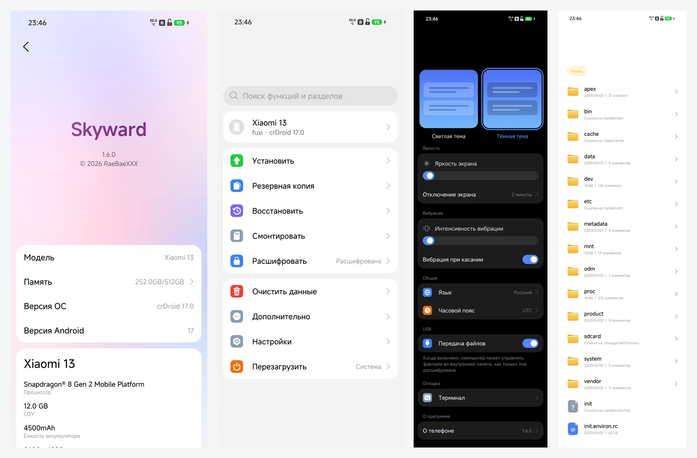
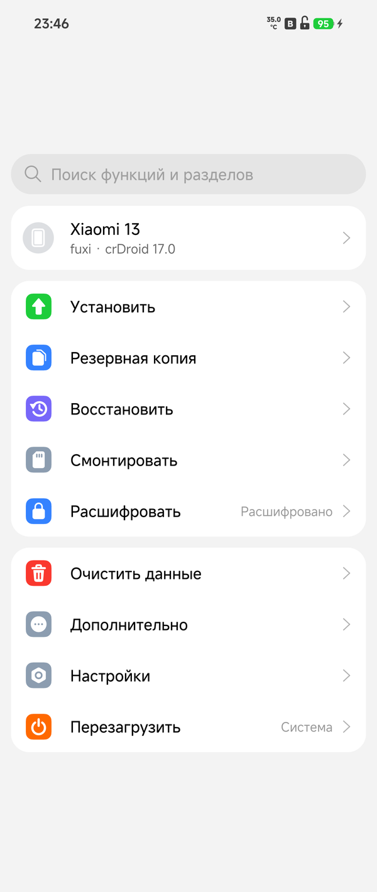
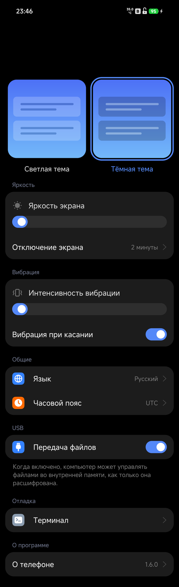
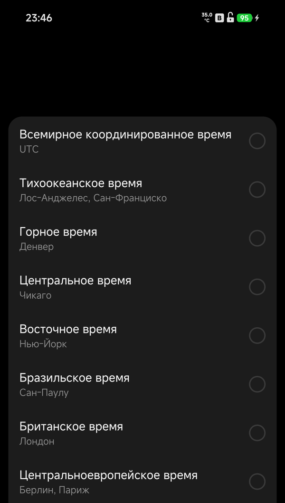

# Skyward for fuxi

[English](README.md) | Русский

Skyward — это recovery, написанный с нуля на Rust. Этот форк посвящён одному
телефону — **Xiaomi 13** (кодовое имя `fuxi`), и его поддерживает
**RaeBaeXXX**. О других устройствах, которые поддерживает upstream-проект, см.
[kirklin/skyward](https://github.com/kirklin/skyward).



<p align="center">
  
  
  
</p>

## Возможности

- Расшифровка раздела data с помощью блокировки экрана
- Установка zip-архивов, пакетов обновления системы и образов разделов из внутренней памяти, с USB-накопителя или через adb sideload
- Онлайн-обновление системы
- Резервное копирование и восстановление
- Очистка данных и сброс к заводским настройкам
- Монтирование разделов, проверка и форматирование файловых систем
- Файловый менеджер и терминал со списком, упорядоченным по имени, размеру или дате
- Беспроводная передача: внутренняя память в браузере по сети
- Скачивание файла по адресу во внутреннюю память
- WLAN
- Передача файлов по MTP, adb и fastbootd
- Перезагрузка в систему, recovery, fastboot, загрузчик или EDL, а также переключение слотов
- Светлая и тёмная темы; английский и русский языки

## Поддерживаемое устройство

| Устройство | Кодовое имя | Проверенная версия системы |
| --- | --- | --- |
| Xiaomi 13 | `fuxi` | crDroid 17.0 (Android 17, сборка от 2026-11-13) |

Расшифровка была проверена на этом телефоне с блокировкой экрана PIN: раздел
data расшифровывается, привязанные к учётным данным файлы владельца
открываются, а внутренняя память доступна для чтения.

Образ собран на основе recovery Android 17 из crDroid 17.0 для fuxi. Этот
recovery сохранён как ресурс `fuxi-a17-recovery.img` релиза `base` данного
репозитория. Стоковый recovery Android 16 нельзя использовать для системы
crDroid 17: его libc++ не может загрузить вендорные бинарники Android 17, из
которых собран сервис ключей.

## Что было проверено

Проверено на телефоне с crDroid 17.0: расшифровка PIN, внутренняя память,
WLAN, MTP, adb, установка полного пакета обновления системы из внутренней
памяти с сохранением Skyward после неё, установка zip-архива GApps с его
собственным скриптом, беспроводная передача в браузер, перезагрузка и страница
«О программе».

Ещё предстоит проверить на телефоне: резервное копирование и восстановление,
очистку, файловый менеджер и терминал, USB-накопители и `adb sideload`,
обновление, двойную загрузку, монтирование, проверку и форматирование
разделов, загрузку через беспроводную передачу, скачивание по ссылке и порядок
файлов.

## Установка

Для Skyward нужен разблокированный загрузчик. Скачайте zip-архив из
[Releases](https://github.com/raebaexxx/skyward-for-fuxi/releases) этого
репозитория; они публикуются из тегов с именами `fuxi-v*`. Сверьте его с
`SHA256SUMS.txt`, распакуйте и прошейте образ из него в раздел recovery,
переведя телефон в режим fastboot:

```sh
unzip skyward-fuxi-v1.6.zip
fastboot flash recovery skyward-fuxi-v1.6.img
fastboot reboot recovery
```

Используйте имя скачанного релиза; zip-архив называется по его тегу.

В дальнейшем более новый образ, распакованный, устанавливается со страницы
Install самого Skyward. При включённой опции **Flash Skyward again** обновление
системы или zip-архив, записывающий поверх раздела recovery, возвращает в него
Skyward.

Без системы в super Skyward всё равно запускается — со своим экраном и
кнопками, adb, `adb sideload` и fastbootd, чего достаточно, чтобы установить
систему. Сенсор, WLAN и расшифровка работают из установленной системы и
возвращаются вместе с ней.

adb в Skyward — это root-оболочка, не требующая авторизации на телефоне: любой,
у кого есть телефон и кабель, может получить доступ к его памяти, пока он
находится в recovery.

## Сборка

Skyward собирается стабильным Rust, указанным в `rust-toolchain.toml`, с его
целью `aarch64-linux-android`, Android NDK r29 и
[cargo-ndk](https://github.com/bbqsrc/cargo-ndk). Служба recovery собирается
для телефона, первая программа его второй системы — статически, а упаковщик —
для компьютера:

```sh
# SKYWARD_VERSION makes the build name the release it is for; a local build
# without it uses the workspace version, 1.6.0.
SKYWARD_VERSION=1.6 \
  cargo ndk -t arm64-v8a --platform 30 build --locked --release -p skyward
RUSTFLAGS="-C target-feature=+crt-static" \
  cargo ndk -t arm64-v8a --platform 30 build --locked --release \
  -p skyward-system-init --target-dir target/system-init
cargo build --locked --release -p skyward-pack
```

За основу взят recovery Android 17 из сборки crDroid, установленной на
телефоне. В этом репозитории хранится тот, на котором тестировались здешние
образы:

```sh
gh release download base --pattern fuxi-a17-recovery.img --dir stock
```

Или возьмите `recovery.img` из локальной сборки crDroid в
`out/target/product/fuxi/`. Затем соберите образ поверх него:

```sh
target/release/skyward-pack recovery \
  --stock stock/fuxi-a17-recovery.img \
  --binary target/aarch64-linux-android/release/skyward \
  --system-init target/system-init/aarch64-linux-android/release/system-init \
  --config devices/fuxi.toml \
  --font resources/fonts/MiSansVF.ttf \
  --mono resources/fonts/KirkMono-Regular.ttf \
  --mono-license resources/fonts/KirkMono-OFL.txt \
  --out target/skyward-fuxi.img
```

Тесты и линты выполняются на компьютере; то, что работает только на телефоне,
проверяется линтом для него:

```sh
cargo test --workspace
cargo clippy --workspace --all-targets -- -D warnings
cargo ndk -t arm64-v8a --platform 30 clippy -p skyward -p skyward-install -p skyward-systems -p skyward-system-init -- -D warnings
```

`skyward-preview` отрисовывает страницы на компьютере в виде PNG-файлов, без
телефона: каждую страницу целиком, как её показывает длинный скриншот, в
возможных для неё состояниях, а также экран в моменты касаний и движения.
`--lang` выбирает язык по локали, например `en` или `ru`:

```sh
cargo run --release -p skyward-preview -- target/preview --lang en
```

## Благодарности

Skyward создан **Kirk Lin** и распространяется под лицензией GPL-3.0-or-later.
Этот форк для fuxi поддерживает **RaeBaeXXX**. Текст интерфейса набран шрифтом
MiSans от Xiaomi; в терминале используется Kirk Mono под лицензией OFL.

## Лицензия

[GPL-3.0-or-later](LICENSE)
